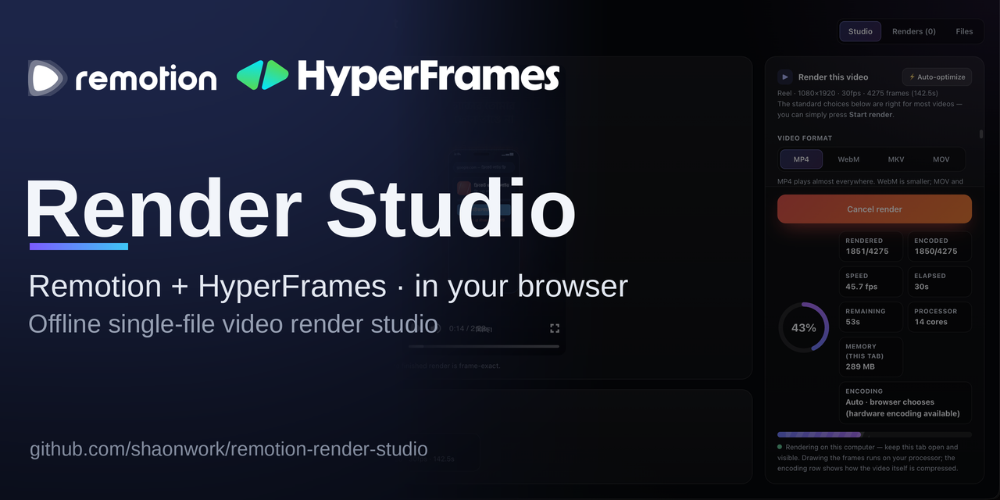
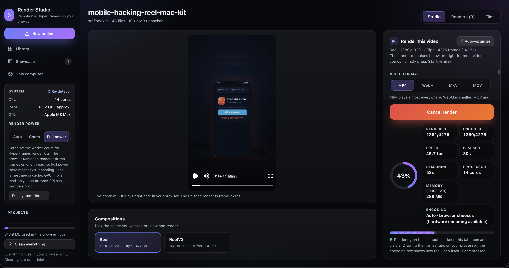
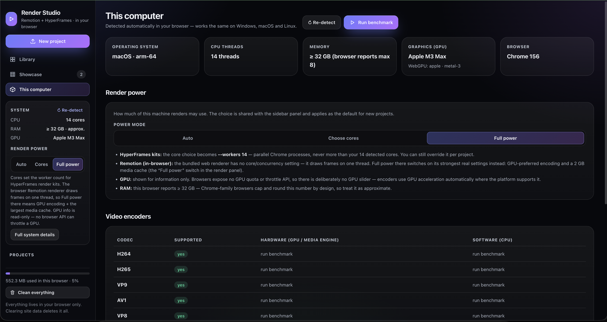

<p align="center">
  <picture>
    <source media="(prefers-color-scheme: dark)" srcset="docs/branding/remotion-logo-on-dark.svg">
    
  </picture>
  &nbsp;&nbsp;&nbsp;&nbsp;&nbsp;
  <picture>
    <source media="(prefers-color-scheme: dark)" srcset="docs/branding/hyperframes-logo-dark.svg">
    
  </picture>
</p>

# Render Studio

**Render Remotion videos right in your browser — no server, no Node.js install, no command line.** Render Studio is a free, offline, single-file web app: open one HTML file, drop in a Remotion project ZIP, preview it live, and export the finished video with WebCodecs. HyperFrames projects are supported too — and nothing you drop in is ever uploaded; everything stays on your machine.

### [▶ Try the live demo](https://remotionstudio24.vercel.app/)

No download needed — or grab the single HTML file from the [latest release](https://github.com/shaonwork/remotion-render-studio/releases) and run it fully offline.




*Render Studio — Remotion + HyperFrames, rendered entirely in your browser.*



*A render in progress: the live details panel shows rendered/encoded frames, measured render speed (fps), elapsed and remaining time, the machine's processor cores and the tab's memory — while the video encodes with WebCodecs.*

**Live version:** https://remotionstudio24.vercel.app — or run the exact same studio offline from [`single/Render-Studio.html`](single/Render-Studio.html).

---

## What it does

Drop any project ZIP (or open a project folder) and the studio figures out by itself which tool made it:

| ZIP you drop | Detected as | What the studio does |
| --- | --- | --- |
| Remotion project (`package.json` depends on `remotion`) | **Remotion** | Compiles it in the browser, previews it live, and renders the finished video with WebCodecs. |
| HyperFrames project (`index.html` with `data-composition-src`) | **HyperFrames** | Plays the real project in the built-in player (timelines, captions and audio in sync), lists its scenes, and generates a **render kit** for the official desktop tool. |
| OpenMontage (the agent system itself) | **OpenMontage** | Explains what it is and how to use it — videos it exports as Remotion/HyperFrames ZIPs are detected automatically when dropped here. |
| Skill pack (`SKILL.md` files — e.g. Motion Design Skills, Anything-to-Explainer) | **Skill pack** | Lists the skills inside and explains how they are used. |
| Anything else | **Unknown** | Shows what was found and which formats are supported. |

Projects and renders are stored in the browser's own IndexedDB. **Your files never leave your computer** — there is no upload, no backend, and no account.

## Screenshots


*The Library: the "Library & cache" card shows how much space the library is using, with one-click backup (one ZIP holding every project and render), restore, and "Clean everything". Your projects and finished renders live below it.*



*"This computer": the studio detects your machine automatically — OS, CPU threads, memory, GPU and browser — lets you choose how much render power to use, and lists which video encoders (H264, H265, VP9, AV1, VP8) your browser supports.*

## Features

### Remotion studio
- **Compiles real projects in the browser** (esbuild WebAssembly) — no Node, no local toolchain.
- **Live preview** with the Remotion Player; the preview always fits the screen, so a 9:16 composition is fully visible without scrolling.
- **In-browser rendering** via `@remotion/web-renderer` and WebCodecs, with live progress: rendered/encoded frame counts, measured render speed (fps), elapsed time and ETA — plus the machine's core count, the encoding path in use (GPU/hardware vs CPU/software, probed with the real WebCodecs capability APIs), and the tab's memory use where the browser reports it.
- **One-tap size presets** — YouTube 1920×1080, Shorts/Reels 1080×1920, Square 1080×1080 — that simply set the size controls, alongside the manual ½×–2× scale.
- **A finish signal**: a short chime (and a system notification, once you allow it) when a render completes.
- **A settings surface that speaks plainly** — video format (MP4, WebM, MKV, MOV), quality, size (½×–2×), how much to render (full video, quick test, or a frame range), sound on/off — with the technical controls (video/audio codecs validated against what your browser can actually encode, hardware vs software encoding, frame-wait patience for heavy projects, keyframe interval, media cache, transparent background for WebM/MKV, input props) under *Advanced settings*.
- **Multiple compositions** per project, picked from one list.

### Audio safety — no more silent videos
- A **pre-flight check** with the renderer's own `canRenderMediaOnWeb` runs before every render with the exact chosen settings. If no audio encoder can be resolved, you get a clear error *before* rendering — not a finished video with no sound.
- A **post-render check** inspects the finished file for an audio track and says so loudly in the result if it is missing.

### HyperFrames studio
- Built-in player that mounts each composition, time-gates elements and seeks the project's GSAP timelines with audio/video in sync.
- **Render-kit generation**: a ZIP with the project plus launchers for the official HyperFrames Studio / CLI, with your settings baked in — format (including HLS), quality / CRF / bitrate control, FPS (up to 240), resolution, worker count, ProRes profiles, GIF looping, HDR/SDR, GPU flags, start/end range, and composition variables. Launcher files keep their executable bit, so they run with a double-click after unzipping.

### Knows your machine
- The **System card** auto-detects CPU cores, approximate RAM, and the GPU model the moment the studio opens.
- **Render power** — Auto, a core count you choose, or Full power. For HyperFrames kits this sets the real `--workers` flag, capped at the cores your machine actually has.
- A **This computer** page with full details and encoder support, plus an *Auto-optimize* button that picks sane settings for your hardware.

### Output & library
- **Save finished videos straight into a folder you choose** (File System Access API): permission is re-checked at save time, success is reported as `Saved to <folder>/<file>`, and if the browser blocks the write you get the file as a download instead, the reason in plain language, and a one-click retry.
- Optionally **keep a copy in the in-browser library**, with thumbnails, a Showcase gallery, and per-project render history.
- Ingest by **drag & drop, file picker, paste, or opening a project folder** — with honest, persistent error messages when a file can't be accepted, and why.
- **Backup & restore**: download the whole library (every project + render) as one ZIP with a manifest, and restore it later — backups are recognised automatically when dropped in, and items come back as new copies, never overwriting.
- **Storage meter + Clean everything**: the Library shows how much space the library and caches are using, and one clearly-marked button wipes everything the studio stores (projects, renders, settings, saved folder, caches) back to a fresh first-run state.

## How to use

1. Get the studio: [`single/Render-Studio.html`](single/Render-Studio.html) from this repo (or open the [live version](https://remotionstudio24.vercel.app)).
2. Open it in **desktop Chrome or Edge** — double-clicking the file works; it runs from `file://` with no server and no internet.
3. Drop a project ZIP anywhere in the window (or click *New project*). The type is detected automatically.
4. Pick a composition, leave the standard settings as they are, and press **Start render**. Finished videos land in your chosen folder and/or the library.

## Build from source

```bash
npm install
npm run build:single   # type-check + build + fold → single/Render-Studio.html
npm run dev            # local dev server (http://localhost:5173)
npm run build          # plain Vite build → dist/
```

`build:single` produces the one self-contained HTML file (~22 MB): every script and style, the esbuild WebAssembly compiler and the media tooling are inlined, so the file runs offline from `file://`. On browsers that block storage for local files, the studio falls back to in-memory storage for the session.

## Project structure

```
remotion-render-studio/
├─ single/                  the deliverable — one self-contained HTML file
│  ├─ Render-Studio.html
│  └─ README-OFFLINE.txt
├─ src/
│  ├─ App.tsx               shell, library, drag & drop / paste / picker ingest
│  ├─ components/           ProjectView (Remotion), HFView (HyperFrames),
│  │                        Gallery, Machine ("This computer"), Home, InfoView
│  └─ lib/                  detect · compile · render · fsa · db · hw ·
│                           zip · host · hfplayer · confirm · util
├─ scripts/make-single.mjs  folds the Vite build into the single HTML file
├─ docs/screenshots/        the screenshots above
└─ UX-RESEARCH.md           the research behind the current interface
```

## Notes

- **Browser support:** rendering needs WebCodecs, so use desktop **Chrome or Edge**. Safari and Firefox can browse the library but cannot render. Saving into a chosen folder also needs Chrome/Edge (File System Access API).
- **Remotion licensing:** the studio defaults to `free-license`, which is only for individuals and teams that qualify for Remotion's [Free License](https://remotion.dev/license). Companies enter their license key under *Advanced settings → Remotion license key*.
- **Supported imports** in uploaded Remotion projects: `remotion`, `react`, `@remotion/{transitions, shapes, paths, noise, layout-utils, media}`, `zod`. The classic `<Audio>` / `<Video>` / `<OffthreadVideo>` components are mapped to `@remotion/media` automatically.
- **HyperFrames preview:** projects that load their own extra runtime scripts may behave slightly differently in the preview; the generated render kit always produces the exact official render.
- **Affiliation:** Render Studio is an independent community tool. It is not affiliated with, sponsored, or endorsed by Remotion AG or HeyGen.

## FAQ

**Can I render Remotion videos without a server?**
Yes — that is the point of this studio. Remotion projects are compiled and rendered entirely in your browser with WebCodecs. There is no render server, no queue, and no upload.

**Do I need Node.js installed?**
No. There is nothing to install: the studio is one self-contained HTML file, with the compiler (the WebAssembly build of esbuild) inlined. Just open it in desktop Chrome or Edge.

**Does it work offline?**
Yes. The single-file build runs from `file://` with no internet connection at all. (The hosted live demo needs internet only to load the page the first time.)

**Are my files uploaded anywhere?**
No. Projects, renders and settings are stored in your browser's own IndexedDB, on your machine. There is no backend: the studio never sends your projects or videos anywhere.

**Remotion or HyperFrames — which projects work?**
Both. Drop a ZIP and the type is detected automatically. Remotion projects are compiled, previewed and rendered in the browser; HyperFrames projects play in the built-in player and can be exported as a render kit for the official desktop tool. OpenMontage exports and skill packs are recognised too.

**What does it cost, and which license applies?**
The studio is free and open source under the MIT License. Remotion itself is covered by Remotion's own license (free for individuals and small teams — see the licensing note above); that license applies to Remotion, not to this studio.

## License

This project is released under the [MIT License](LICENSE).
